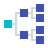
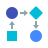

# DUIFx Icon Reference

## Usage

Icons are embedded via the Qt Resource System. Use the resource path `:icons/icon/<Name>.svg`.

### Example: MenuButton (Header)

```python
MenuButton(
    icon_path=":icons/icon/Settings.svg",
    label="Settings",
)
```

### Example: MenuButton (Sidebar)

```python
MenuButton(
    icon_path=":icons/icon/Home.svg",
    tooltip="Home",
)
```

### Example: QIcon

```python
from PySide6.QtGui import QIcon

icon = QIcon(":icons/icon/Home.svg")
button.setIcon(icon)
```

### Example: QPushButton with icon

```python
from PySide6.QtWidgets import QPushButton
from PySide6.QtGui import QIcon

btn = QPushButton()
btn.setIcon(QIcon(":icons/icon/Save.svg"))
btn.setToolTip("Save")
```

### Compile Qt Resource File

After adding or removing icons, recompile the Qt resource file:

```
pyside6-rcc -o resources_rc.py resources.qrc
```

Example with full paths:

```
pyside6-rcc -o .\duifx\gui\ui\resource_rc.py .\duifx\gui\resources\resource.qrc
```

---

## Available Icons

325 icons. Most come from the MIT-licensed
[Flat Color Icons](https://github.com/icons8/flat-color-icons) set — see
[THIRD-PARTY-LICENSES.md](THIRD-PARTY-LICENSES.md). Third-party brand and
product logos from that set have been removed: the artwork is MIT, but the
trademarks it depicts are not Icons8’s to license on.

| Icon | Name | Resource Path |
|------|------|---------------|
|  | about | `:icons/icon/about.svg` |
|  | accept_database | `:icons/icon/accept_database.svg` |
|  | add_column | `:icons/icon/add_column.svg` |
|  | add_database | `:icons/icon/add_database.svg` |
|  | add_image | `:icons/icon/add_image.svg` |
|  | add_row | `:icons/icon/add_row.svg` |
|  | address_book | `:icons/icon/address_book.svg` |
|  | advance | `:icons/icon/advance.svg` |
|  | advertising | `:icons/icon/advertising.svg` |
|  | alarm_clock | `:icons/icon/alarm_clock.svg` |
|  | Alert | `:icons/icon/Alert.svg` |
|  | alphabetical_sorting_az | `:icons/icon/alphabetical_sorting_az.svg` |
|  | alphabetical_sorting_za | `:icons/icon/alphabetical_sorting_za.svg` |
|  | answers | `:icons/icon/answers.svg` |
|  | approval | `:icons/icon/approval.svg` |
|  | approve | `:icons/icon/approve.svg` |
|  | area_chart | `:icons/icon/area_chart.svg` |
|  | arrow-down-icon | `:icons/icon/arrow-down-icon.svg` |
|  | arrow-up-icon | `:icons/icon/arrow-up-icon.svg` |
|  | assistant | `:icons/icon/assistant.svg` |
|  | audio_file | `:icons/icon/audio_file.svg` |
|  | automatic | `:icons/icon/automatic.svg` |
|  | automotive | `:icons/icon/automotive.svg` |
|  | bad_decision | `:icons/icon/bad_decision.svg` |
|  | bar_chart | `:icons/icon/bar_chart.svg` |
|  | bearish | `:icons/icon/bearish.svg` |
|  | binoculars | `:icons/icon/binoculars.svg` |
|  | biohazard | `:icons/icon/biohazard.svg` |
|  | biomass | `:icons/icon/biomass.svg` |
|  | biotech | `:icons/icon/biotech.svg` |
|  | bookmark | `:icons/icon/bookmark.svg` |
|  | briefcase | `:icons/icon/briefcase.svg` |
|  | broken_link | `:icons/icon/broken_link.svg` |
|  | bullish | `:icons/icon/bullish.svg` |
|  | business | `:icons/icon/business.svg` |
|  | business_contact | `:icons/icon/business_contact.svg` |
|  | businessman | `:icons/icon/businessman.svg` |
|  | businesswoman | `:icons/icon/businesswoman.svg` |
|  | butting_in | `:icons/icon/butting_in.svg` |
|  | cable_release | `:icons/icon/cable_release.svg` |
|  | calculator | `:icons/icon/calculator.svg` |
|  | calendar | `:icons/icon/calendar.svg` |
|  | call_transfer | `:icons/icon/call_transfer.svg` |
|  | callback | `:icons/icon/callback.svg` |
|  | camcorder | `:icons/icon/camcorder.svg` |
|  | camcorder_pro | `:icons/icon/camcorder_pro.svg` |
|  | camera | `:icons/icon/camera.svg` |
|  | camera_addon | `:icons/icon/camera_addon.svg` |
|  | camera_identification | `:icons/icon/camera_identification.svg` |
|  | cancel | `:icons/icon/cancel.svg` |
|  | candle_sticks | `:icons/icon/candle_sticks.svg` |
|  | capacitor | `:icons/icon/capacitor.svg` |
|  | cell_phone | `:icons/icon/cell_phone.svg` |
|  | Channels | `:icons/icon/Channels.svg` |
|  | charge_battery | `:icons/icon/charge_battery.svg` |
|  | checkmark | `:icons/icon/checkmark.svg` |
|  | circuit | `:icons/icon/circuit.svg` |
|  | clapperboard | `:icons/icon/clapperboard.svg` |
|  | clear_filters | `:icons/icon/clear_filters.svg` |
|  | clock | `:icons/icon/clock.svg` |
|  | close_up_mode | `:icons/icon/close_up_mode.svg` |
|  | cloth | `:icons/icon/cloth.svg` |
|  | collaboration | `:icons/icon/collaboration.svg` |
|  | collapse | `:icons/icon/collapse.svg` |
|  | collect | `:icons/icon/collect.svg` |
|  | combo_chart | `:icons/icon/combo_chart.svg` |
|  | command_line | `:icons/icon/command_line.svg` |
|  | comments | `:icons/icon/comments.svg` |
|  | compact_camera | `:icons/icon/compact_camera.svg` |
|  | conference_call | `:icons/icon/conference_call.svg` |
|  | contacts | `:icons/icon/contacts.svg` |
|  | copyleft | `:icons/icon/copyleft.svg` |
|  | copyright | `:icons/icon/copyright.svg` |
|  | crystal_oscillator | `:icons/icon/crystal_oscillator.svg` |
|  | currency_exchange | `:icons/icon/currency_exchange.svg` |
|  | cursor | `:icons/icon/cursor.svg` |
|  | customer_support | `:icons/icon/customer_support.svg` |
|  | dam | `:icons/icon/dam.svg` |
|  | data_backup | `:icons/icon/data_backup.svg` |
|  | data_configuration | `:icons/icon/data_configuration.svg` |
|  | data_encryption | `:icons/icon/data_encryption.svg` |
|  | data_protection | `:icons/icon/data_protection.svg` |
|  | data_recovery | `:icons/icon/data_recovery.svg` |
|  | data_sheet | `:icons/icon/data_sheet.svg` |
|  | database | `:icons/icon/database.svg` |
|  | debt | `:icons/icon/debt.svg` |
|  | decision | `:icons/icon/decision.svg` |
|  | delete_column | `:icons/icon/delete_column.svg` |
|  | delete_database | `:icons/icon/delete_database.svg` |
|  | delete_row | `:icons/icon/delete_row.svg` |
|  | department | `:icons/icon/department.svg` |
|  | deployment | `:icons/icon/deployment.svg` |
|  | diploma_1 | `:icons/icon/diploma_1.svg` |
|  | diploma_2 | `:icons/icon/diploma_2.svg` |
|  | disapprove | `:icons/icon/disapprove.svg` |
|  | disclaimer | `:icons/icon/disclaimer.svg` |
|  | dislike | `:icons/icon/dislike.svg` |
|  | display | `:icons/icon/display.svg` |
|  | do_not_inhale | `:icons/icon/do_not_inhale.svg` |
|  | do_not_insert | `:icons/icon/do_not_insert.svg` |
|  | do_not_mix | `:icons/icon/do_not_mix.svg` |
|  | document | `:icons/icon/document.svg` |
|  | donate | `:icons/icon/donate.svg` |
|  | doughnut_chart | `:icons/icon/doughnut_chart.svg` |
|  | down | `:icons/icon/down.svg` |
|  | down_left | `:icons/icon/down_left.svg` |
|  | down_right | `:icons/icon/down_right.svg` |
|  | download | `:icons/icon/download.svg` |
|  | Dx | `:icons/icon/Dx.svg` |
|  | edit_image | `:icons/icon/edit_image.svg` |
|  | electrical_sensor | `:icons/icon/electrical_sensor.svg` |
|  | electrical_threshold | `:icons/icon/electrical_threshold.svg` |
|  | electricity | `:icons/icon/electricity.svg` |
|  | electro_devices | `:icons/icon/electro_devices.svg` |
|  | electronics | `:icons/icon/electronics.svg` |
|  | empty_battery | `:icons/icon/empty_battery.svg` |
|  | empty_filter | `:icons/icon/empty_filter.svg` |
|  | empty_trash | `:icons/icon/empty_trash.svg` |
|  | end_call | `:icons/icon/end_call.svg` |
|  | engineering | `:icons/icon/engineering.svg` |
|  | entering_heaven_alive | `:icons/icon/entering_heaven_alive.svg` |
|  | expand | `:icons/icon/expand.svg` |
|  | expired | `:icons/icon/expired.svg` |
|  | export | `:icons/icon/export.svg` |
|  | external | `:icons/icon/external.svg` |
|  | factory | `:icons/icon/factory.svg` |
|  | factory_breakdown | `:icons/icon/factory_breakdown.svg` |
|  | faq | `:icons/icon/faq.svg` |
|  | feed_in | `:icons/icon/feed_in.svg` |
|  | feedback | `:icons/icon/feedback.svg` |
|  | File Error | `:icons/icon/File Error.svg` |
|  | file | `:icons/icon/file.svg` |
|  | filing_cabinet | `:icons/icon/filing_cabinet.svg` |
|  | filled_filter | `:icons/icon/filled_filter.svg` |
|  | film | `:icons/icon/film.svg` |
|  | film_reel | `:icons/icon/film_reel.svg` |
|  | fine_print | `:icons/icon/fine_print.svg` |
|  | flash_auto | `:icons/icon/flash_auto.svg` |
|  | flash_off | `:icons/icon/flash_off.svg` |
|  | flash_on | `:icons/icon/flash_on.svg` |
|  | flow_chart | `:icons/icon/flow_chart.svg` |
|  | folder | `:icons/icon/folder.svg` |
|  | frame | `:icons/icon/frame.svg` |
|  | full_battery | `:icons/icon/full_battery.svg` |
|  | full_trash | `:icons/icon/full_trash.svg` |
|  | gallery | `:icons/icon/gallery.svg` |
|  | genealogy | `:icons/icon/genealogy.svg` |
|  | generic_sorting_asc | `:icons/icon/generic_sorting_asc.svg` |
|  | generic_sorting_desc | `:icons/icon/generic_sorting_desc.svg` |
|  | globe | `:icons/icon/globe.svg` |
|  | good_decision | `:icons/icon/good_decision.svg` |
|  | graduation_cap | `:icons/icon/graduation_cap.svg` |
|  | grid | `:icons/icon/grid.svg` |
|  | headset | `:icons/icon/headset.svg` |
|  | heat_map | `:icons/icon/heat_map.svg` |
|  | high_battery | `:icons/icon/high_battery.svg` |
|  | high_priority | `:icons/icon/high_priority.svg` |
|  | home | `:icons/icon/home.svg` |
|  | idea | `:icons/icon/idea.svg` |
|  | image_file | `:icons/icon/image_file.svg` |
|  | import | `:icons/icon/import.svg` |
|  | in_transit | `:icons/icon/in_transit.svg` |
|  | info | `:icons/icon/info.svg` |
|  | inspection | `:icons/icon/inspection.svg` |
|  | integrated_webcam | `:icons/icon/integrated_webcam.svg` |
|  | internal | `:icons/icon/internal.svg` |
|  | invite | `:icons/icon/invite.svg` |
|  | key | `:icons/icon/key.svg` |
|  | landscape | `:icons/icon/landscape.svg` |
|  | leave | `:icons/icon/leave.svg` |
|  | left | `:icons/icon/left.svg` |
|  | left_down | `:icons/icon/left_down.svg` |
|  | left_down2 | `:icons/icon/left_down2.svg` |
|  | left_up | `:icons/icon/left_up.svg` |
|  | left_up2 | `:icons/icon/left_up2.svg` |
|  | library | `:icons/icon/library.svg` |
|  | light_at_the_end_of_tunnel | `:icons/icon/light_at_the_end_of_tunnel.svg` |
|  | like | `:icons/icon/like.svg` |
|  | like_placeholder | `:icons/icon/like_placeholder.svg` |
|  | line_chart | `:icons/icon/line_chart.svg` |
|  | link | `:icons/icon/link.svg` |
|  | list | `:icons/icon/list.svg` |
|  | lock | `:icons/icon/lock.svg` |
|  | lock_landscape | `:icons/icon/lock_landscape.svg` |
|  | lock_portrait | `:icons/icon/lock_portrait.svg` |
|  | low_battery | `:icons/icon/low_battery.svg` |
|  | low_priority | `:icons/icon/low_priority.svg` |
|  | make_decision | `:icons/icon/make_decision.svg` |
|  | manager | `:icons/icon/manager.svg` |
|  | Master | `:icons/icon/Master.svg` |
|  | medium_priority | `:icons/icon/medium_priority.svg` |
|  | menu | `:icons/icon/menu.svg` |
|  | middle_battery | `:icons/icon/middle_battery.svg` |
|  | mind_map | `:icons/icon/mind_map.svg` |
|  | minus | `:icons/icon/minus.svg` |
|  | minus_bw | `:icons/icon/minus_bw.svg` |
|  | missed_call | `:icons/icon/missed_call.svg` |
|  | mms | `:icons/icon/mms.svg` |
|  | money_transfer | `:icons/icon/money_transfer.svg` |
|  | multiple_cameras | `:icons/icon/multiple_cameras.svg` |
|  | multiple_devices | `:icons/icon/multiple_devices.svg` |
|  | multiple_inputs | `:icons/icon/multiple_inputs.svg` |
|  | multiple_smartphones | `:icons/icon/multiple_smartphones.svg` |
|  | music | `:icons/icon/music.svg` |
|  | negative_dynamic | `:icons/icon/negative_dynamic.svg` |
|  | neutral_decision | `:icons/icon/neutral_decision.svg` |
|  | neutral_trading | `:icons/icon/neutral_trading.svg` |
|  | news | `:icons/icon/news.svg` |
|  | next | `:icons/icon/next.svg` |
|  | nfc_sign | `:icons/icon/nfc_sign.svg` |
|  | night_landscape | `:icons/icon/night_landscape.svg` |
|  | night_portrait | `:icons/icon/night_portrait.svg` |
|  | no_idea | `:icons/icon/no_idea.svg` |
|  | no_video | `:icons/icon/no_video.svg` |
|  | numerical_sorting_12 | `:icons/icon/numerical_sorting_12.svg` |
|  | numerical_sorting_21 | `:icons/icon/numerical_sorting_21.svg` |
|  | object_directory | `:icons/icon/object_directory.svg` |
|  | ok | `:icons/icon/ok.svg` |
|  | old_time_camera | `:icons/icon/old_time_camera.svg` |
|  | online_support | `:icons/icon/online_support.svg` |
|  | opened_folder | `:icons/icon/opened_folder.svg` |
|  | org_unit | `:icons/icon/org_unit.svg` |
|  | organization | `:icons/icon/organization.svg` |
|  | overtime | `:icons/icon/overtime.svg` |
|  | package | `:icons/icon/package.svg` |
|  | paid | `:icons/icon/paid.svg` |
|  | panorama | `:icons/icon/panorama.svg` |
|  | parallel_tasks | `:icons/icon/parallel_tasks.svg` |
|  | phone | `:icons/icon/phone.svg` |
|  | phone_android | `:icons/icon/phone_android.svg` |
|  | photo_reel | `:icons/icon/photo_reel.svg` |
|  | picture | `:icons/icon/picture.svg` |
|  | pie_chart | `:icons/icon/pie_chart.svg` |
|  | planner | `:icons/icon/planner.svg` |
|  | plus | `:icons/icon/plus.svg` |
|  | plus_bw | `:icons/icon/plus_bw.svg` |
|  | podium_with_audience | `:icons/icon/podium_with_audience.svg` |
|  | podium_with_speaker | `:icons/icon/podium_with_speaker.svg` |
|  | podium_without_speaker | `:icons/icon/podium_without_speaker.svg` |
|  | portrait_mode | `:icons/icon/portrait_mode.svg` |
|  | positive_dynamic | `:icons/icon/positive_dynamic.svg` |
|  | previous | `:icons/icon/previous.svg` |
|  | print | `:icons/icon/print.svg` |
|  | privacy | `:icons/icon/privacy.svg` |
|  | process | `:icons/icon/process.svg` |
|  | puzzle | `:icons/icon/puzzle.svg` |
|  | qr | `:icons/icon/qr.svg` |
|  | questions | `:icons/icon/questions.svg` |
|  | radar_plot | `:icons/icon/radar_plot.svg` |
|  | rating | `:icons/icon/rating.svg` |
|  | ratings | `:icons/icon/ratings.svg` |
|  | reading | `:icons/icon/reading.svg` |
|  | reading_ebook | `:icons/icon/reading_ebook.svg` |
|  | record | `:icons/icon/record.svg` |
|  | redo | `:icons/icon/redo.svg` |
|  | refresh | `:icons/icon/refresh.svg` |
|  | registered_trademark | `:icons/icon/registered_trademark.svg` |
|  | remove_image | `:icons/icon/remove_image.svg` |
|  | reuse | `:icons/icon/reuse.svg` |
|  | right | `:icons/icon/right.svg` |
|  | right_down | `:icons/icon/right_down.svg` |
|  | right_down2 | `:icons/icon/right_down2.svg` |
|  | right_up | `:icons/icon/right_up.svg` |
|  | right_up2 | `:icons/icon/right_up2.svg` |
|  | Risk | `:icons/icon/Risk.svg` |
|  | rotate_camera | `:icons/icon/rotate_camera.svg` |
|  | rotate_to_landscape | `:icons/icon/rotate_to_landscape.svg` |
|  | rotate_to_portrait | `:icons/icon/rotate_to_portrait.svg` |
|  | ruler | `:icons/icon/ruler.svg` |
|  | rules | `:icons/icon/rules.svg` |
|  | safe | `:icons/icon/safe.svg` |
|  | sales_performance | `:icons/icon/sales_performance.svg` |
|  | scatter_plot | `:icons/icon/scatter_plot.svg` |
|  | search | `:icons/icon/search.svg` |
|  | self_service_kiosk | `:icons/icon/self_service_kiosk.svg` |
|  | selfie | `:icons/icon/selfie.svg` |
|  | serial_tasks | `:icons/icon/serial_tasks.svg` |
|  | service_mark | `:icons/icon/service_mark.svg` |
|  | services | `:icons/icon/services.svg` |
|  | settings | `:icons/icon/settings.svg` |
|  | share | `:icons/icon/share.svg` |
|  | shipped | `:icons/icon/shipped.svg` |
|  | shop | `:icons/icon/shop.svg` |
|  | signature | `:icons/icon/signature.svg` |
|  | sim_card | `:icons/icon/sim_card.svg` |
|  | sim_card_chip | `:icons/icon/sim_card_chip.svg` |
|  | Slave | `:icons/icon/Slave.svg` |
|  | slr_back_side | `:icons/icon/slr_back_side.svg` |
|  | smartphone_tablet | `:icons/icon/smartphone_tablet.svg` |
|  | sms | `:icons/icon/sms.svg` |
|  | sound_recording_copyright | `:icons/icon/sound_recording_copyright.svg` |
|  | speaker | `:icons/icon/speaker.svg` |
|  | sports_mode | `:icons/icon/sports_mode.svg` |
|  | stack_of_photos | `:icons/icon/stack_of_photos.svg` |
|  | start | `:icons/icon/start.svg` |
|  | statistics | `:icons/icon/statistics.svg` |
|  | support | `:icons/icon/support.svg` |
|  | survey | `:icons/icon/survey.svg` |
|  | switch_camera | `:icons/icon/switch_camera.svg` |
|  | synchronize | `:icons/icon/synchronize.svg` |
|  | tablet_android | `:icons/icon/tablet_android.svg` |
|  | template | `:icons/icon/template.svg` |
|  | timeline | `:icons/icon/timeline.svg` |
|  | todo_list | `:icons/icon/todo_list.svg` |
|  | touchscreen_smartphone | `:icons/icon/touchscreen_smartphone.svg` |
|  | trademark | `:icons/icon/trademark.svg` |
|  | tree_structure | `:icons/icon/tree_structure.svg` |
|  | two_smartphones | `:icons/icon/two_smartphones.svg` |
|  | Uncheck 1 | `:icons/icon/Uncheck 1.svg` |
|  | Uncheck | `:icons/icon/Uncheck.svg` |
|  | undo | `:icons/icon/undo.svg` |
|  | unlock | `:icons/icon/unlock.svg` |
|  | up | `:icons/icon/up.svg` |
|  | up_left | `:icons/icon/up_left.svg` |
|  | up_right | `:icons/icon/up_right.svg` |
|  | upload | `:icons/icon/upload.svg` |
|  | video_call | `:icons/icon/video_call.svg` |
|  | video_file | `:icons/icon/video_file.svg` |
|  | video_projector | `:icons/icon/video_projector.svg` |
|  | view_details | `:icons/icon/view_details.svg` |
|  | vip | `:icons/icon/vip.svg` |
|  | voice_presentation | `:icons/icon/voice_presentation.svg` |
|  | voicemail | `:icons/icon/voicemail.svg` |
|  | webcam | `:icons/icon/webcam.svg` |
|  | workflow | `:icons/icon/workflow.svg` |
