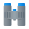
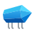

# DUIFx Icon Reference

## Usage

Icons are embedded via the Qt Resource System. Use the resource path `:icons/icon/<Name>.svg`.

### Example: MenuButton (Header)

```python
MenuButton(
    icon_path=":icons/icon/Settings.svg",
    label="Settings",
)
```

### Example: MenuButton (Sidebar)

```python
MenuButton(
    icon_path=":icons/icon/Home.svg",
    tooltip="Home",
)
```

### Example: QIcon

```python
from PySide6.QtGui import QIcon

icon = QIcon(":icons/icon/Home.svg")
button.setIcon(icon)
```

### Example: QPushButton with icon

```python
from PySide6.QtWidgets import QPushButton
from PySide6.QtGui import QIcon

btn = QPushButton()
btn.setIcon(QIcon(":icons/icon/Save.svg"))
btn.setToolTip("Save")
```

### Compile Qt Resource File

After adding or removing icons, recompile the Qt resource file:

```
pyside6-rcc -o resources_rc.py resources.qrc
```

Example with full paths:

```
pyside6-rcc -o .\duifx\gui\ui\resource_rc.py .\duifx\gui\resources\resource.qrc
```

---

## Available Icons

| Icon | Name | Resource Path |
|------|------|---------------|
|  | 3d Pointer | `:icons/icon/3d Pointer.svg` |
|  | About | `:icons/icon/About.svg` |
|  | Add Bookmark | `:icons/icon/Add Bookmark.svg` |
|  | Alert | `:icons/icon/Alert.svg` |
|  | arrow-down-icon | `:icons/icon/arrow-down-icon.svg` |
|  | arrow-up-icon | `:icons/icon/arrow-up-icon.svg` |
|  | Bebo | `:icons/icon/Bebo.svg` |
|  | Binoculars | `:icons/icon/Binoculars.svg` |
|  | Bookmark | `:icons/icon/Bookmark.svg` |
|  | Box | `:icons/icon/Box.svg` |
|  | Briefcase | `:icons/icon/Briefcase.svg` |
|  | Cancel | `:icons/icon/Cancel.svg` |
|  | Check All | `:icons/icon/Check All.svg` |
|  | Check Mark | `:icons/icon/Check Mark.svg` |
|  | Checkmark | `:icons/icon/Checkmark.svg` |
|  | Clock | `:icons/icon/Clock.svg` |
|  | Close | `:icons/icon/Close.svg` |
|  | Connect | `:icons/icon/Connect.svg` |
|  | Contacts | `:icons/icon/Contacts.svg` |
|  | Cursor | `:icons/icon/Cursor.svg` |
|  | Delete | `:icons/icon/Delete.svg` |
|  | Delete Bookmark | `:icons/icon/Delete Bookmark.svg` |
|  | Document | `:icons/icon/Document.svg` |
|  | Done | `:icons/icon/Done.svg` |
|  | Download | `:icons/icon/Download.svg` |
|  | Download from the Cloud | `:icons/icon/Download from the Cloud.svg` |
|  | Dribbble | `:icons/icon/Dribbble.svg` |
|  | Dx | `:icons/icon/Dx.svg` |
|  | Edit | `:icons/icon/Edit.svg` |
|  | External Link | `:icons/icon/External Link.svg` |
|  | Facebook | `:icons/icon/Facebook.svg` |
|  | Favorites | `:icons/icon/Favorites.svg` |
|  | Female User | `:icons/icon/Female User.svg` |
|  | File | `:icons/icon/File.svg` |
|  | File Error | `:icons/icon/File Error.svg` |
|  | Folder | `:icons/icon/Folder.svg` |
|  | For You | `:icons/icon/For You.svg` |
|  | Google Plus | `:icons/icon/Google Plus.svg` |
|  | Hand Cursor | `:icons/icon/Hand Cursor.svg` |
|  | Home | `:icons/icon/Home.svg` |
|  | Icons8 | `:icons/icon/Icons8.svg` |
|  | Idea | `:icons/icon/Idea.svg` |
|  | Image File | `:icons/icon/Image File.svg` |
|  | Info | `:icons/icon/Info.svg` |
|  | Instagram | `:icons/icon/Instagram.svg` |
|  | Key | `:icons/icon/Key.svg` |
|  | LinkedIn | `:icons/icon/LinkedIn.svg` |
|  | LinkedIn Circled | `:icons/icon/LinkedIn Circled.svg` |
|  | Lock | `:icons/icon/Lock.svg` |
|  | Lunacy | `:icons/icon/Lunacy.svg` |
|  | Mailbox | `:icons/icon/Mailbox.svg` |
|  | Menu | `:icons/icon/Menu.svg` |
|  | Music | `:icons/icon/Music.svg` |
|  | MySpace | `:icons/icon/MySpace.svg` |
|  | Myspace 3 | `:icons/icon/Myspace 3.svg` |
|  | Myspace App | `:icons/icon/Myspace App.svg` |
|  | News | `:icons/icon/News.svg` |
|  | No Synchronize | `:icons/icon/No Synchronize.svg` |
|  | Nodes | `:icons/icon/Nodes.svg` |
|  | object_directory | `:icons/icon/object_directory.svg` |
|  | Opened Folder | `:icons/icon/Opened Folder.svg` |
|  | Padlock | `:icons/icon/Padlock.svg` |
|  | Picture | `:icons/icon/Picture.svg` |
|  | Pinterest | `:icons/icon/Pinterest.svg` |
|  | Plus | `:icons/icon/Plus.svg` |
|  | Puzzle | `:icons/icon/Puzzle.svg` |
|  | qr | `:icons/icon/qr.svg` |
|  | record | `:icons/icon/record.svg` |
|  | Reddit | `:icons/icon/Reddit.svg` |
|  | Refresh | `:icons/icon/Refresh.svg` |
|  | Remove Bookmark | `:icons/icon/Remove Bookmark.svg` |
|  | Restart | `:icons/icon/Restart.svg` |
|  | Risk | `:icons/icon/Risk.svg` |
|  | Round | `:icons/icon/Round.svg` |
|  | Scroll | `:icons/icon/Scroll.svg` |
|  | Search | `:icons/icon/Search.svg` |
|  | Services | `:icons/icon/Services.svg` |
|  | Settings | `:icons/icon/Settings.svg` |
|  | Share | `:icons/icon/Share.svg` |
|  | Share_1 | `:icons/icon/Share_1.svg` |
|  | Share_2 | `:icons/icon/Share_2.svg` |
|  | Speech Bubble | `:icons/icon/Speech Bubble.svg` |
|  | StumbleUpon | `:icons/icon/StumbleUpon.svg` |
|  | Sun | `:icons/icon/Sun.svg` |
|  | Synchronize | `:icons/icon/Synchronize.svg` |
|  | Tick Box | `:icons/icon/Tick Box.svg` |
|  | Toolbox | `:icons/icon/Toolbox.svg` |
|  | Trash | `:icons/icon/Trash.svg` |
|  | Trash Can | `:icons/icon/Trash Can.svg` |
|  | Tumblr | `:icons/icon/Tumblr.svg` |
|  | Unavailable | `:icons/icon/Unavailable.svg` |
|  | Uncheck | `:icons/icon/Uncheck.svg` |
|  | Uncheck 1 | `:icons/icon/Uncheck 1.svg` |
|  | Uncheck All | `:icons/icon/Uncheck All.svg` |
|  | Undelete | `:icons/icon/Undelete.svg` |
|  | Upload to the Cloud | `:icons/icon/Upload to the Cloud.svg` |
|  | User Male | `:icons/icon/User Male.svg` |
|  | Wrench | `:icons/icon/Wrench.svg` |
|  | X | `:icons/icon/X.svg` |
|  | X2 | `:icons/icon/X2.svg` |
